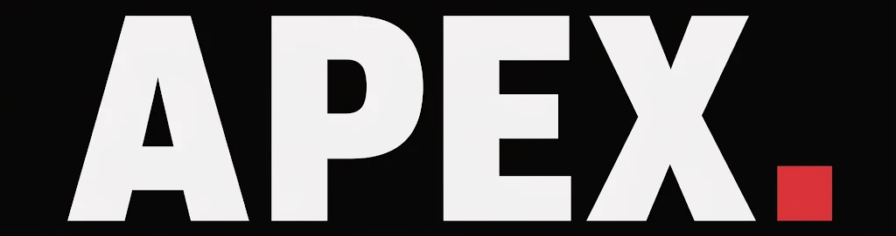

# APEX

**Real Humanoid Combat League**

APEX es una plataforma web de un campeonato ficticio de combate entre robots humanoides, inspirada en la presentación de eventos deportivos profesionales como las artes marciales mixtas (MMA).

El proyecto busca ofrecer una experiencia visual moderna e interactiva en la que los usuarios puedan conocer a los atletas robóticos, consultar sus estadísticas, explorar eventos y disfrutar de los momentos destacados de los combates.

## Características

- **Eventos y boletería:** información sobre próximos combates y selección interactiva de entradas.
- **Atletas T800:** fichas técnicas con estadísticas y características de los robots.
- **Telemetría:** ventanas modales con información detallada de los atletas.
- **Highlights:** galería de videos MP4 con controles de reproducción.
- **Modo claro y oscuro:** cambio dinámico de apariencia mediante JavaScript y Tailwind CSS.
- **Diseño responsive:** interfaz adaptable a dispositivos móviles, tablets y computadores.

## Identidad visual

### Logo



El logotipo de APEX utiliza una composición tipográfica de alto impacto, con letras blancas sobre fondo oscuro y un punto rojo que refuerza la identidad de la marca.

### Paleta de colores

La identidad visual combina tonos oscuros, rojos intensos y grises neutros.

| Color | Código HEX | Aplicación |
|---|---|---|
| Negro principal | `#0B090A` | Fondo general |
| Gris oscuro | `#161A1D` | Tarjetas y contenedores |
| Rojo profundo | `#660708` | Superficies y detalles |
| Rojo oscuro | `#A4161A` | Estados y elementos secundarios |
| Rojo medio | `#BA181B` | Acentos |
| Rojo principal | `#E5383B` | Botones y elementos destacados |
| Gris cálido | `#B1A7A6` | Textos secundarios |
| Gris claro | `#D3D3D3` | Bordes y elementos neutros |
| Blanco suave | `#F5F3F4` | Textos y títulos |
| Blanco | `#FFFFFF` | Contraste y elementos principales |

[Ver paleta completa en Coolors](https://coolors.co/palette/0b090a-161a1d-660708-a4161a-ba181b-e5383b-b1a7a6-d3d3d3-f5f3f4-ffffff)

### Concepto visual

APEX combina la estética de las competiciones deportivas profesionales con elementos de ingeniería robótica.

Su diseño utiliza fondos oscuros, tipografía de alto impacto, imágenes de combate y componentes de interfaz inspirados en plataformas deportivas.

El modo claro ofrece una apariencia alternativa, conservando los colores y elementos representativos de la marca.

## Diseño de interfaz

### Wireframe

El wireframe presenta la estructura inicial y la distribución de las secciones principales de la plataforma.

[Ver wireframe de APEX](https://lovable.dev/preview/WtDCgMQ5gBOEs1HAdO0EOEPhhEec6xHv)

### Mockup

El mockup representa la propuesta visual del sitio, incluyendo colores, tipografía, imágenes y componentes de interfaz.

[Ver mockup de APEX](https://lovable.dev/preview/YRBFY5Wx8lAQzn7GWaEzDylYMrFx0bwz)

## Tecnologías

- **HTML5:** estructura semántica del sitio.
- **Tailwind CSS v4:** estilos, diseño responsive y personalización de la identidad visual.
- **JavaScript:** interactividad, manipulación del DOM y funcionalidades de la interfaz.
- **Node.js y npm:** gestión de dependencias y ejecución de Tailwind CSS.
- **Git y GitHub:** control de versiones y colaboración entre integrantes.

## Instalación y ejecución local

### Requisitos

- Git
- Node.js y npm
- Visual Studio Code (recomendado)

### Pasos

1. Clonar el repositorio:

   ```bash
   git clone https://github.com/Riwi-Coders/apex-kombat.git
   ```

2. Ingresar al proyecto:

   ```bash
   cd apex-kombat
   ```

3. Instalar las dependencias:

   ```bash
   npm install
   ```

4. Ejecutar Tailwind CSS en modo desarrollo:

   ```bash
   npm run dev
   ```

5. Abrir `index.html` utilizando Live Server.

El archivo `css/input.css` contiene la configuración de Tailwind CSS y los estilos personalizados. El archivo `css/output.css` contiene los estilos compilados utilizados por el navegador.

## Organización del proyecto

```text
apex-kombat/
├── index.html
├── css/
│   ├── input.css
│   └── output.css
├── js/
│   └── index.js
├── img/
├── videos/
│   ├── video-apex-1.mp4
│   ├── video-apex-2.mp4
│   ├── video-apex-3.mp4
│   └── video-apex-4.mp4
├── package.json
├── package-lock.json
└── README.md
```

La estructura puede ampliarse al integrar las páginas de eventos y atletas.

## Organización del trabajo

El desarrollo del proyecto se realiza mediante ramas de Git para distribuir las responsabilidades y facilitar la integración del código.

| Rama | Propósito |
|---|---|
| `main` | Versión principal del proyecto |
| `dev` | Integración y revisión de funcionalidades |
| `feature/index` | Página principal y componentes generales |
| `feature/events` | Eventos y boletería |
| `feature/athletes` | Atletas y estadísticas |

Cada funcionalidad se desarrolla en su rama correspondiente y se integra mediante pull requests.

## Estado del proyecto

**En desarrollo e integración.**

APEX es un proyecto académico y demostrativo. Los atletas, campeonatos, estadísticas y eventos pertenecen a un universo ficticio.

La boletería es una simulación y no procesa pagos reales. Los videos corresponden a contenido multimedia demostrativo.

## Equipo

Proyecto desarrollado colaborativamente por la célula **Ex Machina**, durante el proceso de formación en desarrollo de software de RIWI.

**Integrantes:**

- Daniel Felipe Lombana Guevara
- Christopher David Martínez Góngora
- Samuel González López
- Juan David Castañeda Gómez

---

**APEX — Real Humanoid Combat League**

*Only one reaches the apex.*